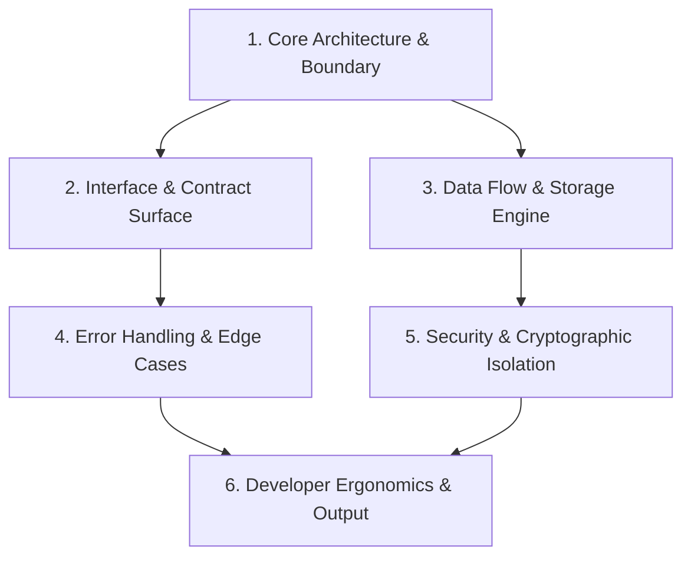

# Question-Me — Interactive Design Tree Resolution & Plan Authoring

> **Protocol Stance:** Interview the operator about every aspect of the task until a shared understanding is reached — walk down each branch of the design tree, resolving dependencies one-by-one; provide recommended answers; ask one question at a time; explore the codebase first.
>
> **Deliverable:** One committed plan document at `.agents/plans/{YYYY-MM-DD}-{slug}.plan.md` — the agent's plan, the clarification ledger, and the todo list it derives, in the shape defined by [`.agents/templates/plan.md`](../../templates/plan.md).
>
> **Environment-Agnostic Delivery:** Conducts the interview through whatever interaction surface the running environment offers — native structured question tools, interactive terminal prompts, or autonomous subagent orchestration — without depending on any specific model, platform, or tooling vendor.

---

## 1. Core Doctrine: The 6 Pillars

1. **Reconnaissance Before Interrogation (Zero Lazy Questions):**
   Never ask the operator a question that the codebase already answers. Before asking anything, inspect git context, the `llms.txt` DOX chain, existing symbols, configurations, dependency manifests, and architectural conventions. If a fact is discoverable from code, establish it as an **Anchor Fact** without bothering the operator.
2. **Topological Dependency Order (Walk the Tree):**
   Structure requirements as a directed tree. Resolve parent architectural decisions before probing child implementation details (e.g., decide *system architecture* before *CLI flag naming*). Downstream branches adapt or prune automatically when upstream decisions change.
3. **Strict Monadic Flow (One Question at a Time):**
   Never barrage the operator with multi-part questions or bulleted checklists. Ask exactly **one** focused question per interaction turn. Await the response, log the decision, update the decision tree, and proceed to the next dependent node.
4. **Opinionated Guidance (Always Recommend):**
   Every question must present concrete, mutually exclusive options, with the optimal choice clearly marked `(Recommended)` and substantiated by engineering rationale, architectural fit, and project standards. The operator can choose to accept the recommendation with a single click/keystroke or choose an alternative.
5. **Environment-Agnostic Delivery:**
   - **Native Structured Questions:** When the environment exposes a structured question tool, deliver the interview through it — options first, recommendation first, user-perspective phrasing, and markdown file links.
   - **Interactive Terminal Prompts:** When no native question tooling exists, output a structured, high-visibility interactive prompt with numbered choices, highlighted recommendations, and write-in support.
   - **Subagent Delegation:** Orchestrator locks design via `question-me` before dispatching implementation or test subagents.
6. **Living Plan Artifact:**
   The plan is the working surface, not a summary written at the end. Open `.agents/plans/{YYYY-MM-DD}-{slug}.plan.md` before the first question, fill §2 Anchor Facts during reconnaissance, append to §4 Clarifications after every answer, and derive §5 Todos only once the walk terminates. A plan whose clarifications were reconstructed from memory at close time is fiction with headings.

---

## 2. Activation Triggers

Invoke or recommend `question-me` when:
- **Operator Invocation:** User runs `/question-me`, or asks to "interview me", "grill me", "help me plan this", or "align on the architecture first".
- **High Ambiguity / Underspecified Scope:** The operator's request has multiple plausible architectural interpretations, missing contracts, or unspecified edge cases.
- **Architectural Fork:** Introducing a new subsystem, choosing between data models, selecting wire protocols, or changing storage layers.
- **Security / PQC / Crypto Decisions:** Introducing secrets handling, authentication flows, or cryptographic primitives (enforcing FIPS 203/204/205).
- **Breaking API Changes:** Modifying public interfaces, CLI flag surfaces, or data schemas that impact downstream consumers.

---

## 3. The 4-Phase Operational Loop

```
┌─────────────────────────┐
│ Phase 0: Reconnaissance │ ➔ Codebase truth, DOX chain, git status
└───────────┬─────────────┘
            ▼
┌─────────────────────────┐
│ Phase 1: Tree Scaffolding│ ➔ Construct hierarchical decision tree
└───────────┬─────────────┘
            ▼
┌─────────────────────────┐
│ Phase 2: Socratic Walk  │ ➔ One question at a time with (Recommended)
└───────────┬─────────────┘
            ▼
┌─────────────────────────┐
│ Phase 3: Plan Compilation│ ➔ .plan.md written, todos derived, worktree dispatch
└─────────────────────────┘
```

The plan file is opened at the start of Phase 0 and updated at every phase boundary — it is not
produced in Phase 3. Phase 3 only completes it: derive the todos, lock `status`, and hand off.

---

### Phase 0: Codebase Reconnaissance & Fact Anchoring

Before drafting the first question, open the plan file and execute passive observation:

0. **Open the plan.** Copy [`.agents/templates/plan.md`](../../templates/plan.md) to
   `.agents/plans/{YYYY-MM-DD}-{slug}.plan.md`, fill the frontmatter (`slug`, `date`, `branch`,
   `worktree`, `task_record`), and set `status: designing`. Write §1 Problem in the operator's own
   terms before anything else — if you cannot, you are not ready to ask questions.
1. **Tree & Branch Check:** Inspect `git status`, `git branch --show-current`, and `git worktree list`. Create the worktree now if the plan is already known to be non-trivial; record its path in the frontmatter.
2. **DOX Chain Walk:** Read repo `llms.txt` and nearest child contracts to absorb conventions and constraints.
3. **Codebase Exploration:** Use `grep_search`, `find_by_name`, or `view_file` to inspect existing patterns:
   - What libraries and dependencies are already pinned?
   - How are similar features implemented elsewhere in this repo?
   - What error-handling and logging paradigms are standard?
4. **Anchor Facts Extraction:** Record known facts in plan §2 — always with the file or command that
   established them:
   ```markdown
   ## 2. Anchor Facts
   - Runtime: Python 3.11 / Rust 2024 / TypeScript 5.6 — from `pyproject.toml`, `Cargo.toml`, `package.json`.
   - Crypto standard: FIPS 203 ML-KEM-768 for secrets; FIPS 204 ML-DSA-65 for signing — from `AGENTS.md`.
   - Persistence: JSON under `~/.config/ainish-coder/`, no SQLite — from `llms.txt` § storage.
   - CLI framework: Bash molecular dispatch / clap 4.5 — from `bin/ainish-coder` and `src/rag/Cargo.toml`.
   ```
   *Rule: Never ask a question whose answer is already an Anchor Fact. When a fact settles what
   would have been a question, also log it in §4 Clarifications marked `asked: resolved from code`,
   so the operator can audit what was decided on their behalf.*

---

### Phase 1: Design Decision Tree Construction

Organize the remaining uncertainties into a strict hierarchical dependency tree.



#### Canonical Decision Levels:
1. **Level 1: System Archetype & Boundary:** (CLI vs. Library vs. Daemon vs. MCP Tool)
2. **Level 2: Contract & Interface:** (JSON schema, CLI flags, function signature, sync vs. async)
3. **Level 3: Storage & State:** (Stateless, filesystem config, memory cache, bundle format)
4. **Level 4: Security & Compliance:** (PQC keys, Zero-Trust validation, permission boundaries)
5. **Level 5: Ergonomics & Polish:** (Output formatting, TTS notifications, verbosity levels)

---

### Phase 2: The Socratic Walk (One Question at a Time)

Walk depth-first down each branch. For each node in the tree:

#### Question Rules:
1. **Format as the user's direct response:** Options must read naturally from the operator's point of view (e.g., *"Store configuration in `~/.config/app/config.json`"* rather than *"You should store configuration..."*).
2. **Put `(Recommended)` first:** Always provide a strong technical recommendation as the first option, accompanied by a brief rationale explaining why it aligns best with existing patterns and quality gates.
3. **No trivial Yes/No questions:** If a decision is binary, elevate it into trade-off alternatives with clear technical consequences.
4. **Include File/Symbol Markdown Links:** When referencing files or symbols, use clickable links: `[config.json](file:///path/to/config.json)` or [`Parser`](file:///path/to/parser.rs#L25-L40).
5. **Prune Dependent Leaves:** If the operator selects Option B that renders downstream questions obsolete, instantly prune those questions from the tree — and record the pruning in the plan's §7 Open Decisions only if a genuinely undecided fork remains.
6. **Log before asking the next question:** Append the decision to plan §4 Clarifications *before* posing the next node. A decision held only in conversation is lost the moment context compacts, and the plan is the artifact that outlives the chat.

#### Question Delivery Modalities:

##### Modality A: Native Structured Question Tooling
When the environment provides a native structured question tool, deliver questions through it:

```json
{
  "questions": [
    {
      "question": "Which interface should expose the new Question-Me protocol?",
      "options": [
        "(Recommended) Dual-channel: Expose both as an automated CLI subcommand (`ainish-coder --question-me`) and as a reusable agent skill in `.agents/skills/question-me/`.",
        "Skill only: Keep it strictly inside `.agents/skills/question-me/` for agent discovery without adding a CLI binary flag.",
        "CLI only: Implement it exclusively as a shell utility in `bin/` without publishing it to target repos as an agent skill."
      ],
      "is_multi_select": false
    }
  ]
}
```

##### Modality B: Interactive Terminal / Headless Delivery
When running in environments without structured question tooling (pure terminal or headless contexts):

```text
================================================================================
[QUESTION-ME] Decision 2/5: Interface & Invocation Model
Target Branch: Interface & Contract Surface
================================================================================
How should the operator trigger the Question-Me interview workflow?

  [1] (Recommended) Slash-command alias & CLI flag: Support `/question-me`
      and `ainish-coder --question-me [DIR]`.
      Rationale: Maximum ergonomics across IDE chat, slash commands,
      and standalone scriptable terminals.

  [2] Slash command only: Restrict to chat-level `/question-me` invocation.
      Trade-off: Simpler surface, but unusable in non-interactive scripts.

  [3] Automatic trigger: Automatically prompt when task ambiguity score > 70%.
      Trade-off: Proactive, but risk of interrupting operators on quick tasks.

  [Custom] Type your custom requirement or press Enter for [1]:
================================================================================
```

##### Modality C: Subagent Master Handoff
When an orchestrator dispatches a task to a subagent (e.g. a headless subagent run carrying an implementation master prompt):
- The orchestrator runs `question-me` with the operator *first*, producing the plan document.
- The subagent receives the **plan path** (`.agents/plans/{date}-{slug}.plan.md`), not a paraphrased brief: the plan already carries the anchor facts, resolved clarifications, and todos, so re-summarizing it into a prompt only introduces drift.
- The subagent receives zero ambiguity, zero open architectural forks, and a locked specification; it owns §5 checkboxes and `status`, and reports back against them.

---

### Phase 3: Plan Compilation & Implementation Hand-off

Once every branch reaches a terminal leaf node:

1. **Derive §5 Todos from the finished tree.** Sections 1-4 are the input; the todos are what an
   implementing agent will actually execute. Each item names the file or symbol it touches, states a
   `done when:` condition that is observable rather than a judgement call, and a `verify:` command.
   Derivation rules live in [Plan Artifacts](references/plan-artifacts.md).
2. **Fill §6 Verification** with the gates that must pass before `status: done`. Reuse the repo's
   existing gates rather than inventing new ones; a check nobody runs is decoration.
3. **Lock the plan.** Set `status: ready` in the frontmatter. From this point §4 Clarifications is
   history: append-only, never rewritten.
4. **Create the task record** at the path named in the plan's `task_record` frontmatter key, with a
   `plan:` line pointing back at the plan. The two artifacts split the work — the plan owns
   reasoning and progress, the task owns coordination state (lane, branch, scope, status, verdict)
   and receives the COMMS lifecycle lines.
5. **Present the locked plan** to the operator: the path, the worktree, the todo count, and the
   gates. Then proceed into implementation per `AGENTS.md`.

There is no separate prose blueprint. The plan file *is* the blueprint; re-typing it into the chat
creates a second copy that drifts the moment either is edited.

```markdown
# Task: {short title}

- lane: now
- branch: {type}/{scope}-{slug}
- status: in-progress
- plan: .agents/plans/{YYYY-MM-DD}-{slug}.plan.md
- scope: {paths}
- objective: {one line}

## Progress

Tracked as checkboxes in plan §5 — do not duplicate the list here.
```

---

## 4. Question Formulation Standards

### Anatomy of an Elite Question
Every question produced by `question-me` must satisfy five tests:
- **Test 1: Specificity:** Does it name concrete architectural entities, paths, or protocols?
- **Test 2: Exclusivity:** Are the options genuinely distinct technical paths, rather than false dichotomies?
- **Test 3: Rationale-backed:** Does the `(Recommended)` option explain *why* based on codebase constraints?
- **Test 4: User-centric Voice:** Are options written from the user's perspective (`"Deploy as a module"`, not `"I will deploy..."`)?
- **Test 5: Non-redundancy:** Could this question have been answered by running `git status` or checking `package.json`?

### Comparison Table: Poor vs. Elite Questions

| Category | ❌ Poor Question (Rejection) | ✅ Elite Question (Question-Me Standard) |
|---|---|---|
| **Ambiguity** | "How do you want to handle errors?" | "When an upstream API returns HTTP 502/504, how should the CLI retry?<br>1. (Recommended) Exponential backoff with jitter up to 3 attempts, then exit with code 2.<br>2. Fail fast immediately without retry.<br>3. Infinite retry loop until operator presses Ctrl+C." |
| **Bikeshedding** | "What should the function name be?" | *(Do not ask; adopt repo convention e.g. `sync_state()` or `resolve_tree()`)* |
| **Lazy Discovery** | "Are you using TypeScript or Rust for this project?" | *(Do not ask; read `Cargo.toml` or `package.json` during Phase 0)* |
| **Multi-Part Barrage** | "What database should we use, how should we seed it, and where will backups live?" | Split into 3 dependency-ordered turns. Question 1: Database engine. Await answer. Question 2: Backup architecture. Await answer. Question 3: Seeding strategy. |
| **Unopinionated** | "Here are 4 options. Which one do you prefer?" | List options with Option 1 marked `(Recommended)` with explicit reasoning linking back to system goals. |

---

## 5. Security & Cryptographic Guardrails

1. **Zero Secret Exposure:** Never ask the operator to input raw API keys, private passwords, or tokens during an interview. If an integration requires authentication, recommend loading via `pqc-secrets` (`~/.config/pqc-secrets/secrets.bundle.json` wrapped with FIPS 203 ML-KEM-768).
2. **PQC Defaulting:** When architectural decisions touch cryptographic integrity or signing, always recommend Post-Quantum algorithms (FIPS 203 for encapsulation, FIPS 204 ML-DSA-65 for signatures, FIPS 205 SLH-DSA for backup signatures) per repo DOX rules.
3. **Least Privilege Scope:** Always recommend minimal file-access and sandbox boundaries when designing new tool or MCP interfaces.

---

## 6. The Plan Artifact

The session's durable output is one file: `.agents/plans/{YYYY-MM-DD}-{slug}.plan.md`, copied from
[`.agents/templates/plan.md`](../../templates/plan.md). Do not restate its full shape here — a second
copy of a template is a copy that drifts. What matters at this level is the frontmatter contract and
the section ownership.

### Frontmatter

```yaml
---
plan_format: ainish/plan/v1
slug: {kebab-name}
date: {YYYY-MM-DD}
status: designing          # designing -> ready -> implementing -> done | abandoned
branch: {type}/{scope}-{slug}
worktree: {absolute path}
task_record: .agents/tasks/{YYYY-MM-DD}-{slug}-task.md
operator: question-me
---
```

`status` is the one field every reader depends on: `ainish-rag` orientation reports it, and the
implementing agent sets it. Treat an unknown value as `designing`.

### Section ownership

| Section | Owner | Mutability |
|---|---|---|
| §1 Problem, §2 Anchor Facts, §3 Plan | Authoring agent | Frozen once `status: ready` |
| §4 Clarifications | Authoring agent | Append-only after lock; never rewritten |
| §5 Todos | Implementing agent | The only section edited in place — tick boxes, do not reorder |
| §6 Verification | Authoring agent writes, implementing agent runs | Frozen once `status: done` |
| §7 Open Decisions | Any agent | Append; a new fork moves `status` back to `designing` |

The task record keeps its existing shape and gains exactly one line — `plan: <relative path>` —
so the coordination record and the design record can never lose each other.

---

## 7. Plan Lifecycle

A plan outlives the chat that produced it, so its mutation rules must be explicit.

1. **`designing`** — the walk is in progress. §1 and §2 fill first; §4 grows one entry per answer;
   §3 is drafted as the tree resolves. A second agent must not edit this plan.
2. **`ready`** — every branch reached a leaf, §5 and §6 are written, and the operator has seen the
   path. Implementation may start. §4 is now history.
3. **`implementing`** — the implementing agent ticks §5 boxes and nothing else. If a clarification
   proves wrong, it does not silently diverge: it appends to §7, sets `status: designing`, and
   returns the plan to the operator.
4. **`done`** — every box ticked and every §6 gate green. Record the outcome in the task record and
   the daily COMMS ledger; the plan itself is not edited again.
5. **`abandoned`** — reason in §7. A plan abandoned without a reason is indistinguishable from one
   forgotten.

A plan superseded by a later plan gets a line in §7 naming the successor. Never delete a plan or
reuse its slug: the filename is a durable reference that task records and commit messages point at.

---

## 8. Reference Files

- [Decision Tree Templates](references/decision-tree-templates.md) — Pre-built decision tree archetypes for common engineering scenarios.
- [Questioning Anti-Patterns](references/anti-patterns.md) — Catalog of questioning failures and concrete remedies.
- [Plan Artifacts](references/plan-artifacts.md) — Deriving todos, splitting a plan, and closing one out.
